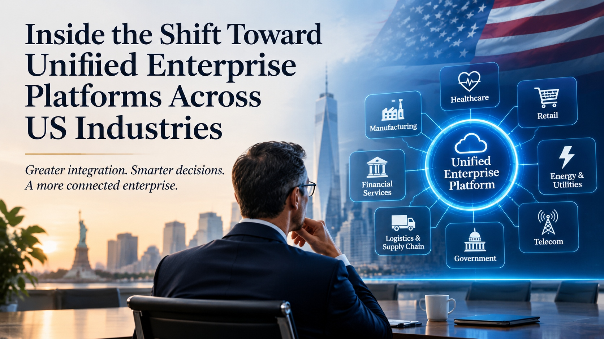

# Inside the Shift Toward Unified Enterprise Platforms Across US Industries

**BRIEFING MEMO**

| | |
|---|---|
| **Subject** | Why US organizations are moving from separate systems to unified enterprise platforms |
| **Audience** | Executives and technology leaders |
| **Read time** | About 5 minutes |

## Bottom Line Up Front

Across US industries, organizations are consolidating separate applications into connected platforms, so that finance, operations, customers, and compliance draw on one trusted set of information. The goal is not fewer tools for their own sake. It is faster decisions, fewer manual handoffs, and less time spent reconciling numbers that disagree.

Most organizations do not get there by replacing everything at once. They get there through careful, staged [Enterprise System Modernization Services USA](https://zignuts.com/REPLACE-WITH-SERVICE-PAGE?utm_source=seo_web2.0&utm_medium=backlink&utm_campaign=seo_referral&utm_id=10) that retire the oldest dependencies first and connect what remains.

This memo explains what is driving the shift, how it looks in eight sectors, and the decisions leaders face before they start.

---

## Three Forces Behind the Shift

1. **Decisions need one version of the truth.** When sales, finance, and operations each hold their own figures, meetings turn into reconciliation.
2. **Integration costs keep rising.** Every new tool added to a separate stack adds another connection to build and maintain.
3. **Regulation and risk reward visibility.** It is easier to show who did what, and when, on a connected platform than across a dozen systems.

## Sector Snapshot

The same idea takes a different shape in each sector.

| Sector | What gets connected | A common obstacle |
|---|---|---|
| **Manufacturing** | Production, inventory, and finance data | Older plant systems |
| **Healthcare** | Clinical, scheduling, and billing workflows | Strict privacy requirements |
| **Retail** | Inventory, ordering, and customer data across channels | Many separate sales channels |
| **Financial services** | Customer, risk, and compliance information | Heavy regulatory scrutiny |
| **Energy and utilities** | Asset, field, and billing systems | Aging field infrastructure |
| **Logistics and supply chain** | Orders, shipments, and carrier data | Many external partners |
| **Telecom** | Network, customer, and billing systems | Very large customer volumes |
| **Government** | Case, records, and citizen-service systems | Long-standing system mandates |

## What "Unified" Means, and What It Does Not

| It means | It does not mean |
|---|---|
| Shared, trusted data across functions | One giant application that does everything |
| Systems that connect through clear interfaces | Replacing every system at once |
| One view for leaders, with role-based access | One view of everything for everyone |
| Retiring duplicate tools with a plan | Removing tools that still do their job well |

## A Staged Path

- **Assess.** List systems, owners, data flows, and the points where people re-enter or reconcile data.
- **Align.** Agree which system owns which record, and which outcomes the consolidation must improve.
- **Connect.** Link the highest-value systems first and measure the effect before widening the scope.
- **Retire.** Switch off duplicates only after users and data have moved safely.

## Risks to Manage

- **Data quality.** Combining systems exposes duplicates and conflicts that were hidden before.
- **Security and access.** One platform concentrates information, so permissions must be precise.
- **Change fatigue.** People rely on familiar tools, so training and communication carry real weight.
- **Scope creep.** A staged plan with clear stop points protects the budget.

## Decision Checklist

- [ ] We can name the three decisions slowed most by disconnected data
- [ ] Each key record has one owning system
- [ ] We know which systems are unsupported or costly to keep
- [ ] Security and compliance are part of the plan from the start
- [ ] A named executive owns the outcome
- [ ] We have a baseline to measure improvement against

---

**Ready to plan your modernization?** Visit [zignuts.com](https://zignuts.com/?utm_source=seo_web2.0&utm_medium=backlink&utm_campaign=seo_referral&utm_id=10) to speak with the team.
